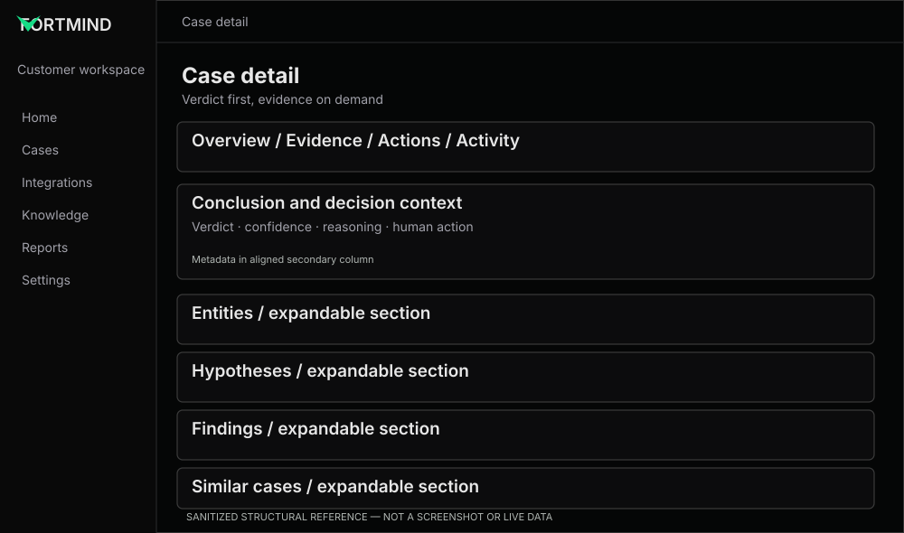

# Investigation detail — verdict to evidence

**Reference:** REF-05. **Priority:** P0.

## Preserve
The screenshot shows top-level **Overview | Evidence | Actions | Activity**. Preserve actual deployed information architecture, including any live variations. Within Overview keep the verdict/conclusion visible, then bounded expandable sections for entities, attack path, hypotheses, findings and similar cases.

## Improve
- **FM-13:** conclusion hierarchy: verdict, confidence, decision source, concise explanation and next action in one logical surface.
- **FM-14:** consistent bordered section headers and content; section remains a single container while expanded.
- **FM-15:** normalize count labels, chips, long identifiers, entity lists and nested evidence.
- **FM-16:** ensure hypothesis confidence and supporting/refuting findings retain their meaning; no false implication of certainty.
- **FM-17:** provide accessible accordion behavior, focus, reduced-motion support and correct collapsed/expanded state.
- **FM-18:** inspect Evidence, Actions and Activity tabs **in the real app** before recommending changes. These screenshots do not show their bodies.

## Component code
- [Investigation Section](../../../examples/case-detail/investigation-section.tsx)

## Important product question
The synthetic benign setup example contains **“Confirmed affected”** badges. Validate whether that means “part of case” or actual compromise. Proposed neutral label if the former: **Observed entity**; do not change semantics without owner approval.

## Acceptance
Reviewers can understand the conclusion within seconds; every expandable section contains heading and content within one border; evidence provenance is visible; no result is invented; long descriptions remain readable.
