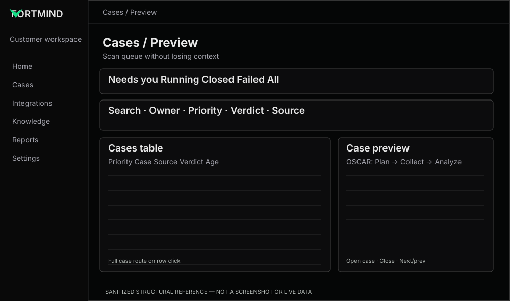

# Cases — queue, filtering and contextual preview

**References:** REF-03 table, REF-04 preview. **Priority:** P0.

## Preserve
- Status tabs: **Needs you, Running, Closed, Failed, All**.
- Search and Owner/Priority/Verdict/Source filters, compact vs comfortable density and clear sorting.
- A full investigation route distinct from contextual preview.

## Improve
- **FM-07:** use one shared column model for table header and body padding/alignment.
- **FM-08:** unambiguous filter state, URL/query persistence where existing, reset actions, zero-results state.
- **FM-09:** row click opens the full case; dedicated preview affordance opens side preview, if confirmed with the app's current interaction pattern.
- **FM-10:** preview keeps table useful at desktop widths; on narrow viewports use a dismissible overlay rather than crushing columns.
- **FM-11:** show OSCAR lifecycle, who needs to act, primary CTA, relevant case metadata and accurate stage labels.
- **FM-12:** keyboard open/close, ESC, focus restoration, previous/next navigation and non-overlapping click targets.

## Component code
- [Case Preview](../../../examples/cases/case-preview.tsx)
- [Shared Investigation Timeline](../../../examples/shared/investigation-timeline.tsx)

## Acceptance
Header and cell baselines match; no clipped control row; preview data matches selected case; loading/empty/error handled; tab/filter counts honest; focus returns to trigger on close; no table layout jump.

## Client decision
Confirm whether row click should open the full case and the trailing cell button should open a preview, or whether the current product intentionally differs.
