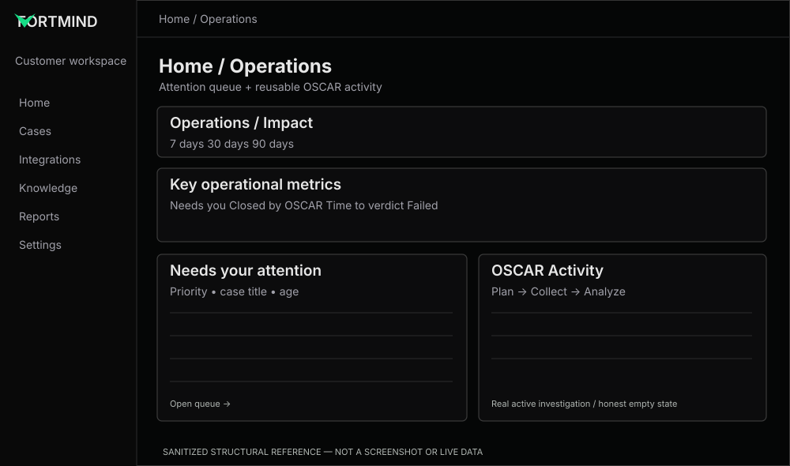

# Home — Operations & Impact

**References:** REF-01 Operations, REF-02 Impact. **Priority:** P0 for OSCAR activity; P0 for KPI verification.

## Preserve
- Top-level **Operations | Impact** tabs and relevant 7/30/90-day filtering.
- Compact overview cards and a prominent **Needs you** queue.
- Neutral surfaces, subtle borders, sharp typography and restrained FortMind accent.

## Improve
- **FM-01:** responsive content frame, consistent tabs, accessible selected state and keyboard focus.
- **FM-02:** human-attention queue with consistent priority, title, age, click target and clear empty state.
- **FM-03:** add genuine **OSCAR Activity**: case link, current phase, elapsed/duration, blocked state and outcome without implying all cases are live.
- **FM-04:** reuse the lifecycle timeline primitive with Cases preview; do not duplicate the markup.
- **FM-05:** verify metric units, periods, percentage-change baselines and edge cases; show small-baseline context.
- **FM-06:** keep Operations visually quieter than a CRM dashboard; prioritize what is automated and what needs humans.

## Component code
- [OSCAR Activity](../../../examples/home/oscar-activity.tsx)
- [Shared Investigation Timeline](../../../examples/shared/investigation-timeline.tsx)
- [Metric display](../../../examples/reports/metric-card.tsx)

## Acceptance
Real data + empty/loading/error states; no fabricated progress; an obvious link to investigation; tab labels and data periods agree; dark and light at 390/768/1440; accessible tab/row focus.

## Client decision
Should OSCAR Activity show **only currently running** cases, or also a “Recently completed” group? Confirm before deciding the data query.
