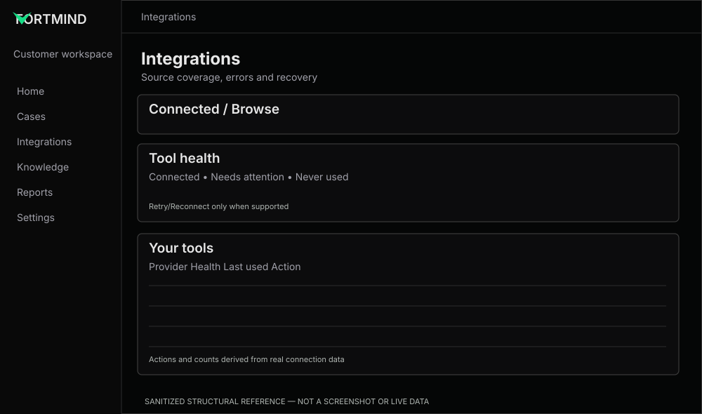

# Integrations — tool coverage and honest health

**References:** REF-06 connected tools, REF-07 browse catalog. **Priority:** P1 (health P0 if featured in demo).

## Preserve
Connected/Browse tabs, integrated providers, provider-specific details and actions.

## Improve
- **FM-19:** reconcile summary counts with row states: connected, needs attention, never used.
- **FM-20:** clear semantic states: connected/healthy, degraded, error, expired and never-called (not necessarily broken).
- **FM-21:** action text should be specific: Manage, Reconnect, Update credentials, Retry test when supported.
- **FM-22:** catalog filtering/category/search and provider cards should be consistent at different densities.
- **FM-23:** never imply a failed integration successfully enriched a case; show last success/failure where data exists.

## Component code
- [Tool Health](../../../examples/integrations/tool-health.tsx)

## Acceptance
Summary totals follow source data; disabled/unavailable actions are explicit; provider names and error reasons are accessible; keyboard and responsive patterns work; no exposed API tokens or hidden configuration values.
