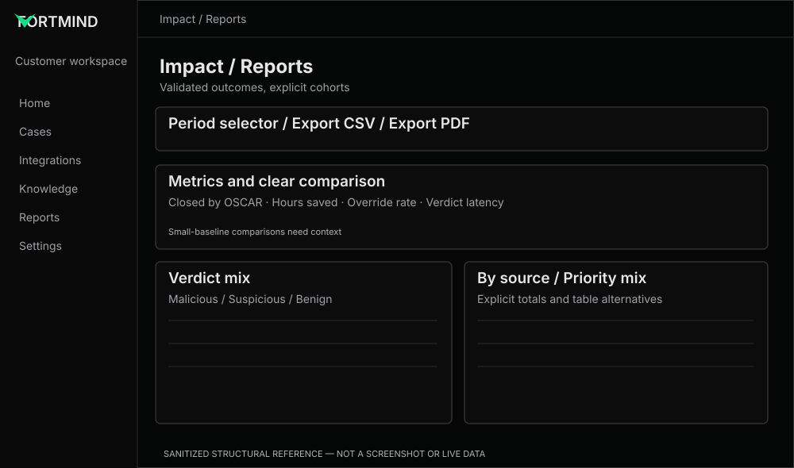

# Reports & Impact — trustworthy value storytelling

**References:** REF-02 Impact, REF-08 Reports. **Priority:** P0 for math/semantics, P1 for visual polish.

## Improve
- **FM-24:** define and verify `cases opened`, `cases decided`, `closed by OSCAR`, `hours saved`, `override rate`, `median time to verdict`.
- **FM-25:** ensure report interval, timezone, comparison cohort and export range reconcile.
- **FM-26:** handle zero/near-zero baselines without absurd relative percentage changes; show absolute deltas, contextual notes or N/A as appropriate.
- **FM-27:** make verdict mix, priority mix and source breakdown comparable using consistent labels, totals, color semantics and accessible table alternative.
- **FM-28:** show sample size, assumption for time saved and transparent error/empty states.

## Example
- [Metric Card](../../../examples/reports/metric-card.tsx) — intentionally receives pre-calculated truthful comparison semantics rather than implementing product math.

## Acceptance
No KPI is hardcoded; units and denominators are right; chart legends + tabular alternatives; CSV/PDF exports match visible period; long numbers are readable; both themes.

## Product clarification
0 cases **opened** and 1 case **decided** in the same period can be valid if the decision pertains to a case opened earlier. Explain cohort difference rather than changing the totals.
