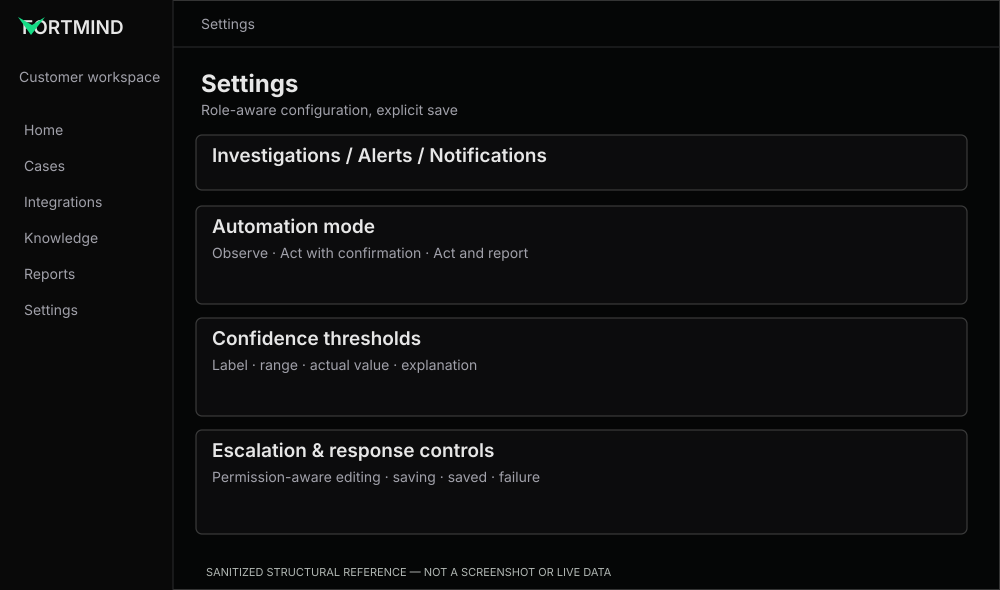

# Settings — compact, comprehensible and permission-safe

**Reference:** REF-09. **Priority:** P1 unless essential to demo.

## Preserve
Organization-level settings, investigations, alerts, escalation, responses and impact controls; existing tab/anchor structure.

## Improve
- **FM-29:** maintain one consistent row layout: heading/explanation in one column, control/help/status in the other.
- **FM-30:** explain automation modes and confidence thresholds; do not conceal business rules behind unlabeled sliders.
- **FM-31:** enforce permissions through backend + UI; do not make read-only controls appear editable.
- **FM-32:** distinguish default, modified, saving, saved and failed-save states with precise feedback.
- **FM-33:** protect signing secrets, org identifiers and endpoints; never log/publish real values in public screenshots.

## Component code
- [Setting Row](../../../examples/settings/setting-row.tsx)

## Acceptance
Keyboard-operable controls with labels, accessible errors and explicit save behavior; responsive stacking; dark/light contrast; no dangerous default changes or credential exposure.
